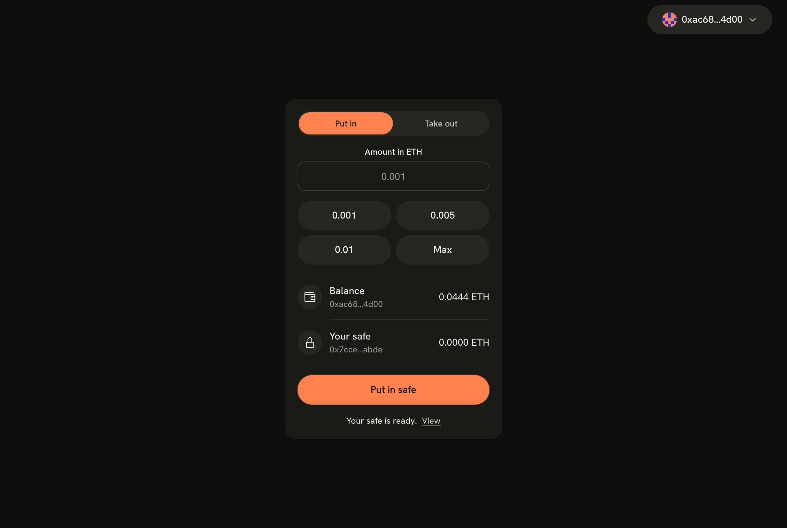

# Simple Safe

A locked box for your crypto. Anyone can put ether in. Only your wallet can take it out.

One small contract and one page, with no web3 libraries: the page talks to MetaMask directly.



> **Test network only.** Simple Safe runs on Sepolia, has not been audited, and is a learning project. Do not use it with real money.

## What it does

1. **Connect** your MetaMask wallet.
2. **Create your safe.** The page deploys a contract that your wallet owns.
3. **Put money in** and **take it out.** A pop-up shows the transfer in flight, then a tick or a cross.

The page remembers your safe's address in this browser, one safe per wallet.

## How it works

### The contract

[`contracts/Safe.sol`](contracts/Safe.sol) is the whole contract:

```solidity
contract Safe {
    address public owner;

    constructor() {
        owner = msg.sender;
    }

    receive() external payable {}

    function withdraw(uint256 amount) public {
        require(msg.sender == owner, "not the owner");
        (bool ok, ) = owner.call{value: amount}("");
        require(ok, "send failed");
    }
}
```

- Whoever deploys it becomes the `owner`.
- `receive()` accepts ether from anyone.
- `withdraw` checks that the caller is the owner, then sends the ether to the owner.

### The page

[`lib/safe.ts`](lib/safe.ts) holds everything that touches the chain. It uses `window.ethereum`, the object MetaMask adds to the page, and nothing else:

| Action | What is sent |
|---|---|
| Create a safe | A transaction with no `to`, whose `data` is the compiled contract |
| Put money in | A plain transfer to the safe, which triggers `receive()` |
| Take money out | A call whose `data` is `0x2e1a7d4d` (the id of `withdraw(uint256)`) followed by the amount in wei |
| Read a balance or the owner | `eth_getBalance` and `eth_call`, which cost nothing |

[`app/page.tsx`](app/page.tsx) is the screen.

## Run it

You need:

- Node.js 22.18 or newer
- The [MetaMask](https://metamask.io) browser extension
- A little Sepolia test ether, free from a faucet such as [Google Cloud's](https://cloud.google.com/application/web3/faucet/ethereum/sepolia)

```bash
npm install
npm run dev
```

Open <http://localhost:3000>.

**MetaMask tip:** if a transaction fails, untick "Added protection" in the MetaMask confirmation window and try again. With it ticked, MetaMask routes the call through its own contract.

## Check it

```bash
npm test           # the amount and transaction helpers
npm run typecheck
npm run lint
npm run build
```

## Rebuild the contract

The compiled contract is stored as `BYTECODE` in `lib/safe.ts`. To reproduce it:

```bash
npx solc@0.8.30 --bin --optimize -o out contracts/Safe.sol
```

Paste the contents of the `.bin` file in `out/` into `BYTECODE`, after the `0x`.

## Limits

- **A stolen key opens the safe.** The contract only checks who is calling. Whoever holds your wallet's key is the owner. A delay on withdrawals and a second guardian key that can cancel them would fix this, and neither is built yet.
- **Not audited.** Nobody has reviewed the contract for security.
- **Sepolia only.** On connect, the page asks MetaMask to switch to Sepolia.
- **MetaMask only.**
- **The safe's address lives in your browser.** Clear the site's data and the page forgets it. The safe and its ether stay on the network, so save the address: the wallet menu shows it before you start over, and "Use a safe I already have" brings it back.

## Project layout

```
contracts/Safe.sol     the contract
lib/safe.ts            talking to the chain
lib/safe.test.ts       tests for the helpers
app/page.tsx           the screen
app/accent.css         the orange accent, as an override of Lime's tokens
components/lime/       Lime design system components
components/ui/         the circuit board animation
```

## Credits

- Interface built with the [Lime design system](https://design.how/systems/lime) from design.how.
- Circuit animation from the `@componentry/circuit-board` registry component.
- Built on [Next.js](https://nextjs.org).

The files under `components/lime`, `lib/lime` and `components/ui` come from those projects and remain under their own terms.

## License

[MIT](LICENSE) for the code written for this project.
